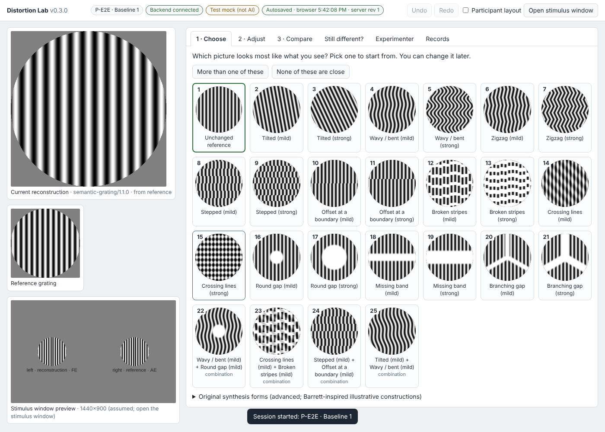

# Distortion Lab

A local research prototype for **percept matching**. Participants with anisometropic, strabismic or mixed amblyopia
view a grating through the amblyopic eye in a dichoptic mirror stereoscope. They then reconstruct the perceived
distortion with an adjustable picture viewed through the fellow eye. This is a research tool. It is not a medical
diagnosis tool and not a drug-administration protocol.

Version 0.3.0. Runs entirely on the lab computer: a small Python (3.9+, standard library only) backend plus a
browser UI. No internet connection, accounts or AI are needed.



## Install once, then get updates automatically

On the lab Mac, open Terminal and clone the repository once:

```bash
cd ~ && git clone https://github.com/bwinsto2/distortion-lab.git
```

(If macOS offers to install the developer command-line tools for `git`, accept.) After that, the launchers run
`git pull` every time they start, so new versions pushed to GitHub arrive automatically. Your session data in `data/`
is never touched by updates. To skip the update for a run, start it with `DISTORTION_LAB_NO_UPDATE=1`. Every saved
session records the software version it was made with.

## Start it

**macOS:** in Finder, open the `distortion-lab` folder in your home folder and double-click **`Distortion Lab.command`**,
or **`Distortion Lab (with Claude).command`** for AI suggestions through your Claude plan
(one-time setup in [docs/AI_BRIDGE.md](docs/AI_BRIDGE.md)). The first time, right-click → Open to approve it.
**Any system:**

```bash
python3 run.py
```

The console opens at <http://127.0.0.1:8765/>. Options: `--port 8765`, `--data ./data`, `--no-browser`.
Sessions are stored in `./data/` (or `$DISTORTION_LAB_DATA`). Stop with Ctrl+C.
Starting it again while an earlier copy is still running stops the earlier copy and takes over (your data is kept). If
an earlier copy can't be stopped, for example one started by an older version, it starts on the next free port and tells you.

**Browser-only preview:** open `web/index.html` directly in a browser. Everything except the backend features works:
gallery, sliders, comparisons, pins, undo/redo, description capture and JSON/PNG downloads. A banner states what is
unavailable: server-side session files and the SQLite index, Python-rendered export bundles, the AI bridge and external
dials. In this mode, autosave goes only to the browser's local storage.

## The matching workflow

0. **Start.** The start screen asks for the **participant ID** (a pseudonymous code), the **session** name and the
   amblyopic eye, which sets the routing: reference on the amblyopic eye's side. It also offers to continue an
   unfinished session. *Practice without an ID* is available for demonstrations.

1. **Choose.** A gallery of thumbnails rendered from the current reference grating: unchanged reference, tilted, wavy,
   zigzag, stepped, offset, broken, crossing lines, round gap, missing band and branching gap, each mild and strong, plus
   combinations. Participants pick the closest one. **More than one of these** lets them pick two features and see
   four combinations (each mild/strong pairing). They can revise the choice at any time.
   **None of these are close** goes straight to description capture. The ten original "Barrett-inspired" forms are
   available under *Original synthesis forms (advanced)*. Researcher labels can be hidden.
2. **Adjust.** Higher-order sliders such as bend amount/spacing, zigzag/step strength/spacing/corner style, offset
   amount/boundary (and limiting bends, zigzags, breaks or crossing lines to one side of that boundary), break extent/spacing, gap size/position/shape/stripe visibility, crossing strength/angle/spacing,
   and orientation/frequency/phase/contrast. Only relevant controls are shown at first. **+ feature** reveals more,
   **more controls** shows advanced ones, and you can switch between fine and coarse slider steps. Each control can be
   **pinned**.
3. **Compare.** **Show alternatives** shows four nearby versions next to the current one. They mix single and
   coordinated two-parameter changes, are deterministic and seeded, and use coarse or fine spacing.
   **More, closer to current** repeats with a smaller neighbourhood. Choosing one updates the same reconstruction and
   its sliders. **Keep current** changes nothing. The focus can be a single feature. **Click any picture** to preview it
   full size, in the main view and the stimulus window, without choosing it. ← → flip between them, and *large pictures* enlarges
   the tiles. After choosing, **Undo** returns to the same alternatives so a different one can be chosen.
4. **Still different?** Captures the participant's **verbatim** description, an optional dragged area on the picture,
   and optional property hints. From here you can request alternatives focused on a property, record an outcome
   (*matches, close, can't be matched, keeps changing, can't tell, can't see it*), ask the optional AI bridge, or export
   a development request. The current version is always preserved, and nothing forces a successful match.

**Undo/Redo** (buttons, Ctrl/Cmd+Z, Ctrl/Cmd+Shift+Z) covers slider edits (each drag is one step), candidate choices,
gallery choices, combinations, mixing, pins and component edits.

**Experimenter tab** (hidden in *Participant layout*):
- **Session:** pseudonymous participant/condition labels and notes; new, open/import, JSON download, PNG exports
  (reconstruction, reference, display) and a backend export bundle.
- **Records:** "record current reconstruction" and the list of saved sessions.
- **Reference grating:** the target, adjustable here.
- **Optics:** left/right/both/neither visibility, reference side, AE/FE eye routing (optionally linked to the reference
  side), circular or Gaussian aperture, diameter, σ, nominal px/° with a calculator, separation, vertical offset,
  fixation mark, and simultaneous, sequential (alternating) or toggle comparison at one fixed position.
  Optics and calibration are kept whenever the form changes.
- **Tools:** built-in checks and AI status.

**Stimulus window:** *Open stimulus window*, drag it to the stereoscope display, then press **F** for fullscreen
presentation. It draws exactly what the console sends and has no controls. Screen position does not isolate the eyes;
the stereoscope does.

## Data, persistence and privacy

- **Autosave.** Every change is saved to the browser's local storage and, when the backend is running, to
  `data/sessions/<id>.json`. Each save is an atomic write that keeps the previous revision, and an SQLite index records
  revision hashes.
- **Resume.** After a crash or reload, the console offers to resume the interrupted session.
- **What is saved.** Target, current and accepted reconstructions, renderer ID/version, all parameters, pins,
  proposal sets (seed, settings, candidates, choice), coarse/fine settings, the full undo/redo history and action log,
  verbatim descriptions with regions, outcomes, timestamps and software version.
- **Export bundles** contain the session JSON plus PNGs rendered by the Python reference renderer, which matches the
  browser pixel for pixel. That is enough to regenerate exact images from parameters.
- **Labels and examples.** Use pseudonyms only. All bundled examples are synthetic.
- **Original prototype files** (`distortion-lab/session/1`) import with their provenance preserved.

## Documentation

| | |
|---|---|
| [docs/MODEL.md](docs/MODEL.md) | equations for both renderers, proposals, pins, provenance and **limitations** |
| [docs/PARAMETERS.md](docs/PARAMETERS.md) | every control: range, steps, proposal size, default |
| [docs/API.md](docs/API.md) | controller API (mouse = keyboard = dials = scripts), backend endpoints, dial relay, session format, dev requests |
| [docs/AI_BRIDGE.md](docs/AI_BRIDGE.md) | optional AI suggestions: Claude through your Claude plan (recommended), or OpenAI API; off by default |
| [docs/TESTING.md](docs/TESTING.md) | how to run the tests and the results of this build |
| [psychopy/](psychopy/) | untested PsychoPy display example built on `distortion_lab/presentation.py` |
| [examples/](examples/) | synthetic session, semantic gallery JSON, rendered example images |
| [existing-prototype/](existing-prototype/) | the original single-file prototype, presets and images (unchanged) |
| [docs/brief/](docs/brief/) | the original build brief |

## Project layout

```
run.py, Distortion Lab.command, start.sh   launchers
distortion_lab/                            Python backend: server, storage (JSON+SQLite), model (validation,
                                           renderers, PNG), ai_bridge, presentation boundary
web/                                       console (index.html), stimulus window, core.js (shared logic),
                                           draw.js, app.js, data.js (generated from shared/)
shared/                                    parameters.json (single schema source), legacy-presets.json
tests/                                     Python unittest, Node core tests, Playwright end-to-end
tools/                                     build_data, param_table, make_examples, render_examples, run_tests, make_zip,
                                           build_preview (single-file browser-only preview)
```

After editing `shared/*.json`, run `python3 tools/build_data.py` and `python3 tools/param_table.py`.

## Important limitations

- The software is tested. Its **perceptual validity is not**: no software check shows that a reconstruction matches a
  percept, or that a match is unique.
- Geometry is nominal. Measure the diameter and px/° through the stereoscope. No gamma, luminance or timing calibration
  is provided.
- The semantic generator (masks, warps, breaks) is our explicit construction and is **not part of the Olianezhad et al.
  model**. The ten original forms are independent illustrative constructions, not fitted parameters or participant
  percepts. The *abrupt offset* and *three-branch gap* forms are known approximations. See [docs/MODEL.md](docs/MODEL.md).
- The Claude-plan AI option was tested live through Claude Code. The OpenAI API option has not been exercised
  against the live service (no credentials were available). The PsychoPy adapter is an untested example.

Source for the original synthesis family: Olianezhad et al. (2025), J. Neurosci.,
DOI [10.1523/JNEUROSCI.1111-25.2025](https://doi.org/10.1523/JNEUROSCI.1111-25.2025).
